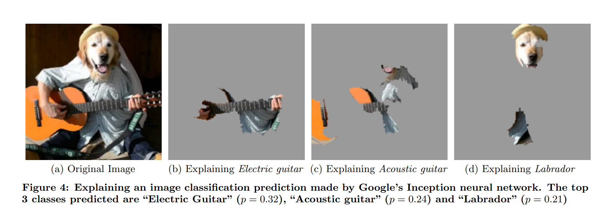

</img>

## Local Interpretable Model-Agnostic Explanations (LIME)

<p align="center">
  <i>When life gives you LIMEs,<br>
  make orange juice.</i><br>
  <sub>&nbsp;&nbsp;&nbsp;&nbsp;&nbsp;&nbsp;&nbsp;&nbsp;&nbsp;&nbsp;&nbsp;&nbsp;&nbsp;&nbsp;&nbsp;&nbsp;— someone probably</sub>
</p>

Implementation of ([Ribeiro et al. 2016](https://arxiv.org/abs/1602.04938))

## Usage

```python
from lime import LimeImageExplainer
from torchvision.models import resnet18, ResNet18_Weights

device = torch.device("cuda" if torch.cuda.is_available() else "cpu")
model = resnet18(weights=ResNet18_Weights.DEFAULT)
explainer = LimeImageExplainer(model, device)

image_path = "image.png"
explainer.explain(image_path).visualize()
```

## Citations
```bibtex 
@article{ribeiro2016lime,
  title         = {{"Why Should I Trust You?": Explaining the Predictions of Any Classifier}},
  author        = {Ribeiro, Marco Tulio and Singh, Sameer and Guestrin, Carlos},
  journal       = {arXiv preprint arXiv:1602.04938},
  year          = {2016},
  doi           = {10.48550/arXiv.1602.04938},
  url           = {https://arxiv.org/abs/1602.04938}
}
```